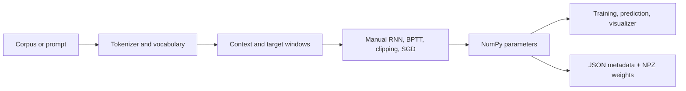

# NextWord AI

An educational next-word predictor built with a Vanilla RNN implemented directly in NumPy. It uses no pretrained model or external inference service. The included original mini-corpus makes first use possible without downloads.

## Features

- Train a one-target-per-context Vanilla RNN on the sample text or a UTF-8 `.txt` upload.
- Monitor actual epoch loss, elapsed time, and progress during training.
- Inspect top-5 or top-10 probabilities and the recurrent calculations for a prompt.
- Compare fresh independent runs in the Experiment Lab using train, validation, and held-out test loss.
- Review experiment summaries saved locally as JSON and compare runs on the same corpus fingerprint and split.
- Explore high-level, RNN-cell, and unrolled architecture diagrams with actual token activations.
- Compare sequence hidden states, sentence edits, logits, and probabilities using the same checkpoint.
- Inspect parameter and last-gradient heatmaps, dimensions, and calculated parameter counts.
- Compare held-out RNN metrics with an add-one-smoothed bigram baseline.
- Inspect corpus frequencies, train-only vocabulary, split sizes, and input-target examples.
- Save a local JSON + NPZ checkpoint.
- Run finite-difference checks and unit tests using `unittest`.

The corpus is intentionally small for demonstration. The model learns only patterns present in that text and has no general world knowledge.

## Architecture



`model/text.py` handles normalization and windows; `model/rnn.py` contains the only forward and gradient implementations; `training/trainer.py` runs SGD; `model/checkpoint.py` handles persistence; `app.py` renders Streamlit pages.

`ui/` contains architecture and chart helpers. `training/data.py` creates split-isolated windows, `training/evaluation.py` implements held-out metrics and the bigram baseline, and `training/experiments.py` creates independent runs.

## Mathematics

For vocabulary size V and hidden size H, one-hot input `x_t` has shape `(V,1)`, hidden state `(H,1)`, and logits `(V,1)`.

```text
a_t = W_xh x_t + W_hh h_(t-1) + b_h
h_t = tanh(a_t)
o   = W_hy h_T + b_y
p   = softmax(o)
L   = -log(p[target])
```

Softmax subtracts the maximum logit before exponentiation. The output cross-entropy derivative is `p - one_hot(target)`. BPTT propagates hidden gradients backwards through the context using `da_t = dh_t * (1 - h_t²)`. The implementation sums parameter gradients over time, optionally clips their global norm, and applies SGD. Parameters total `2VH + H² + H + V`.

Each fixed-length context predicts the following token. The ordered token stream is split before windowing so no context window crosses a train, validation, or test boundary. Every experiment uses a fresh model; its vocabulary is built from training tokens only, and unseen held-out words map to `<unk>`. Comparisons are grouped by corpus fingerprint and train/validation split. Test loss is held out until training completes. Training is sequential and intentionally small; there is no batching, dropout, or shuffled data.

## Windows setup

```powershell
python -m venv .venv
.\.venv\Scripts\Activate.ps1
python -m pip install -r requirements.txt
python -m unittest discover -s tests -v
python -m streamlit run app.py
```

If activation is blocked by PowerShell policy, use ` .\.venv\Scripts\python.exe -m pip install -r requirements.txt` and ` .\.venv\Scripts\python.exe -m streamlit run app.py` (omit the leading spaces).

## Training and prediction

Run the app, choose Train RNN or Experiment Lab, select an optional corpus and hyperparameters, then train. The dashboard reports measured train and validation losses, gradient norms, and clipped update counts each epoch. Every experiment saves its own checkpoint. Prediction Visualizer and RNN Architecture Explorer use the same `VanillaRNN.forward` calculation; unknown words map to `<unk>` and are reported.

Navigation includes Home / Overview, Train RNN, RNN Architecture Explorer, Prediction Visualizer, Sequence Explorer, Hidden-State Explorer, Experiment Lab, Model Inspector, Evaluation & Bigram Comparison, Dataset Manager, and Experiment History.

## Checkpoints

Each run saves JSON metadata and NPZ arrays under `saved_models/experiments/<run-id>/`; the loader disables pickle and validates parameter and gradient shapes. NPZ contains model weights and the last applied gradient snapshot. Summaries are in `saved_models/experiments.json`. Runtime files on Streamlit Community Cloud may disappear after restarts or redeploys.

## GitHub and deployment

From this folder, create a repository on GitHub, then:

```powershell
git init
git add .
git commit -m "Build NextWord AI educational RNN"
git branch -M main
git remote add origin https://github.com/USERNAME/REPOSITORY.git
git push -u origin main
```

See [DEPLOYMENT.md](DEPLOYMENT.md) for Streamlit Community Cloud steps. Deployment is not performed by this repository setup.

## Limitations and next steps

Small corpora give narrow, often repetitive predictions. The ordered test tail may be small, so evaluation is a teaching metric rather than a robust benchmark. Graphviz nodes are not natively clickable in Streamlit; select a named component in the explorer to inspect its real tensor and heatmap. Experiment summaries and checkpoints live on the local filesystem; cloud restarts can erase them. Uploads are limited to 2 MB in the UI.
